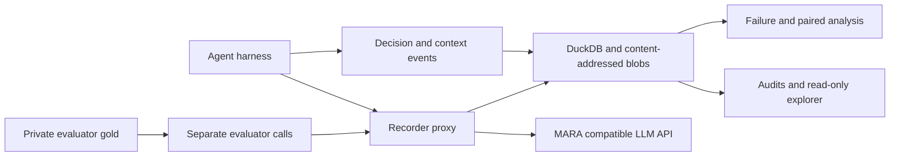

# FinDER agent design research: purpose and handoff

This setup asks: **which question structures benefit from decomposition,
multiple agents, context exchange or review, at a bounded execution budget?**
It also asks where each model fails: knowledge/evidence, reasoning, output
interface, tool dispatch, context delivery, synthesis, provider availability or
budget. The practical outcome is evidence for choosing an agent design per
workload, with costs and failure modes visible.

It is an opt-in research setup. Production ontology/query policies are outside
these experiments. The public repository includes implementation, synthetic
fixtures, tests and aggregate reports. Original FinDER corpora, keys, raw model
transcripts and local stores remain private.

## What is being measured

A comparison has four separate layers:

1. **Transport evidence:** actual prompts, outputs, parameters, model names,
   usage, latency and provider errors recorded at the LLM API boundary.
2. **Execution evidence:** public tasks/dependencies, tools, delivered context,
   returned findings, budget admission and final synthesis with source IDs.
3. **Evaluation:** answer correctness/support, units/periods, missing evidence
   and abstention; model judgments are calibrated separately from deterministic
   receipts and human review.
4. **Experiment:** matched cases, evidence, model and budget ceilings; paired
   differences and explicit unknown outcomes instead of aggregate success alone.



Every paid LLM call in these runners passes the Recorder. Public plans and
actual calls are observable; private chain-of-thought is neither requested nor
reconstructed. FinDER `reasoning` is the original **reasoning-required boolean**,
not whether an answer's reasoning is correct, and is not derived from `type`.
Gold answers/references/domain/reasoning annotations stay evaluator-only.

## Current experiment question

The single-agent pilot studied public execution paths. The next matched
comparison isolates cooperation:

| Arm | Execution/context |
|---|---|
| direct | One source-grounded answer |
| single_decomposition | One identity, two fixed tasks, explicit prior-result context, synthesis |
| independent_parallel | Separate task identities, independent concurrent work, synthesis |
| sequential_context | Separate identities, explicit previous findings, synthesis |
| peer_review | Independent work, reciprocal findings, one review round, synthesis |

Fixed task templates are identical across planned arms. Single versus separate
sequential identities is an **identity-only negative control**: identical
model-visible packets may produce similar behavior. Agent names alone are not
an intervention with inherent reasoning benefit. Independent/peer arms change
information flow. The harness uses host-scheduled SDK instances and explicit
packets; this matched cohort does not claim persistent session memory or native
handoff. Earlier native `Agent.as_tool()` and `handoff()` designs are separate
experiments in `agent/collaboration.py`.

Common per-run request/output ceilings are used; actual consumption varies.
The matched cohort disables coordination-specific additions to the answer
judge (`judge_coordination=False`) to keep the answer rubric common. Actual
context delivery remains recorded. Semantic context use, redundant work, error
correction and faithful synthesis require additional adjudication: a transfer,
shared citation or revised output is not proof of these properties.

## Code map: read in this order

| Concern | Source |
|---|---|
| Experiment schema and opt-in controls | [config.py](../src/seocho/eval/agent_observability/config.py) |
| Orchestration, context delivery, budget and judging | [harness.py](../src/seocho/eval/agent_observability/harness.py) |
| Recorded SDK transport | [openai_agents.py](../src/seocho/recorder/adapters/openai_agents.py) |
| Full transport capture | [proxy.py](../src/seocho/recorder/proxy.py) |
| CAS/DuckDB, calls and event audits | [store.py](../src/seocho/recorder/store.py), [events.py](../src/seocho/recorder/events.py) |
| Model-selected tools and specialist return | [tool_agent.py](../src/seocho/eval/agent_observability/tool_agent.py) |
| Public path/metacognition schemas | [execution_path.py](../src/seocho/eval/agent_observability/execution_path.py), [metacognition.py](../src/seocho/eval/agent_observability/metacognition.py) |
| Private evaluation, deterministic receipts | [evaluator.py](../src/seocho/eval/agent_observability/evaluator.py) |
| Source-linked variants, suite ordering/admission, failure analysis | [quality_lab.py](../src/seocho/eval/agent_observability/quality_lab.py) |
| Read-only raw/graph inspection | [ui.py](../src/seocho/recorder/ui.py), [views.py](../src/seocho/recorder/views.py) |
| Earlier native delegation/handoff graph experiment | [collaboration.py](../src/seocho/agent/collaboration.py) |
| Contract regression tests | [test_quality_lab.py](../tests/seocho/test_quality_lab.py), [test_agent_tools.py](../tests/seocho/test_agent_tools.py), [test_recorder.py](../tests/seocho/test_recorder.py) |

Broader modules provide isolated Pi inference, pinned replay/knock-in,
controlled synthetic/adversarial variants, derived silver signals and population
reports. Start with the core map above, then [the full contract](AGENT_OBSERVABILITY.md).
Silver consensus is a proxy, not subtask gold or proof of evidence use.

## Verified research status (2026-10-13)

The completed exploratory single-agent cohort used12 original cases from12
companies, reasoning False6/True6, five MARA models, direct/explicit/adaptive
arms and two requests per cell: **360 trials**. There were229 execution/evaluation
completions,131 failures,235 generated answers and1553 physical API requests.
All360 finalized call/event audits passed. Completion is not correctness.

Failures were36 schema validations,39 budget exhaustions,29 provider429s,
16 truncated-output/provider400s,10 SDK model-behavior errors and1 other
validation. Thirteen exceptions named APIConnectionError were budget-flagged,
so exception names alone do not establish network faults. Interface/evaluator
failures must not become incorrect-answer labels.

The five models were DeepSeek-V3.1, DeepSeek-V3.2, MiniMax-M3, Gemma4-31B-it and
gpt-oss-120b. Four used API schema; MiniMax used prompt JSON, a cross-model
interface confound. Gemma judged answers, with self-judging bias. The twelve
questions and seed42 repetition are exploratory, not representative population
rankings or proof of stable model reasoning signatures. Human calibration is
pending. Aggregate reports describe privately retained evidence; raw data is
not redistributed here.

The new matched cohort is **prepared but not live-executed**:12 cases ×2
inference models (Gemma/gpt-oss) ×5 arms ×2 samples =240 assignments. The
planned judge is DeepSeek-V3.2. The execution server became unreachable before
launch. Its0 live trials must not be replaced by Mock compatibility/quality
claims. See [matched protocol/status](experiments/finder-matched-coordination-2026-10-12.md).

## Start with contract-only execution

Install from the branch checkout:

```bash
uv sync --extra ci --extra recorder
uv run python examples/agent-observability/acceptance_phase2.py --help
uv run python examples/agent-observability/acceptance_phase2.py \
  --directory outputs/agent-observability/mock-acceptance
```

The acceptance runner starts local Mock/Recorder services and audits source
receipts. It makes no paid model request. Mock outputs verify contracts, not
answer quality, provider compatibility or performance.

[Examples](../examples/agent-observability/README.md) describe subsequent replay,
report and UI commands. The shipped
[matched suite](../examples/agent-observability/quality-lab.matched.yaml) is a
configuration template, not a bundled FinDER dataset. Before live execution,
privately prepare cases and evaluation artifacts through `prepare-finder`,
combine selected cases, then `quality_lab prepare` to freeze lineage/hashes.
Point the YAML at that prepared directory and keep original cases across all
matched arms. A one-case dataset creates fewer than240 assignments.

Only explicitly run the following after configuring private data and the
credential environment:

```bash
# terminal 1: credential environment is required; never place it in YAML
uv run obs serve --config examples/agent-observability/recorder.mara.yaml
# terminal 2: paid, bounded requests through the Recorder
uv run python -m seocho.eval.agent_observability.quality_lab run \
  --config examples/agent-observability/quality-lab.matched.yaml \
  --output outputs/agent-observability/matched/results.json
```

Stop the Recorder writer before offline analysis/read-only inspection. Preserve
raw records and partial failures, inspect admission totals, and never blindly
overwrite/repeat a paid cohort. Global caps reserve output tokens/request counts;
input tokens and money are not capped by that reservation. Provider prices and
unreported reasoning tokens remain unknown.

## Next agent's task

1. Read repository AGENTS.md and the
   [matched ExecPlan](execplans/multi-agent-matched-coordination.md).
2. Recover the authorized execution environment and inspect existing results
   before dispatching a new paid run. Transfer current code, not a stale copy.
3. Execute/audit the matched cohort, retain every failure and stage distinction.
4. Compare each case/sample against single decomposition; report inference and
   judgment availability separately, costs, actual context packets and review
   changes. Adjudicate candidate gains and harms with human review.
5. Conclude which workload structures benefit and at what budget; do not claim
   that many agents, more public steps, agreement or higher token counts are
   intrinsically better. Graph/ontology tool necessity requires a separate
   counterfactual experiment with available, provenance-backed artifacts.
